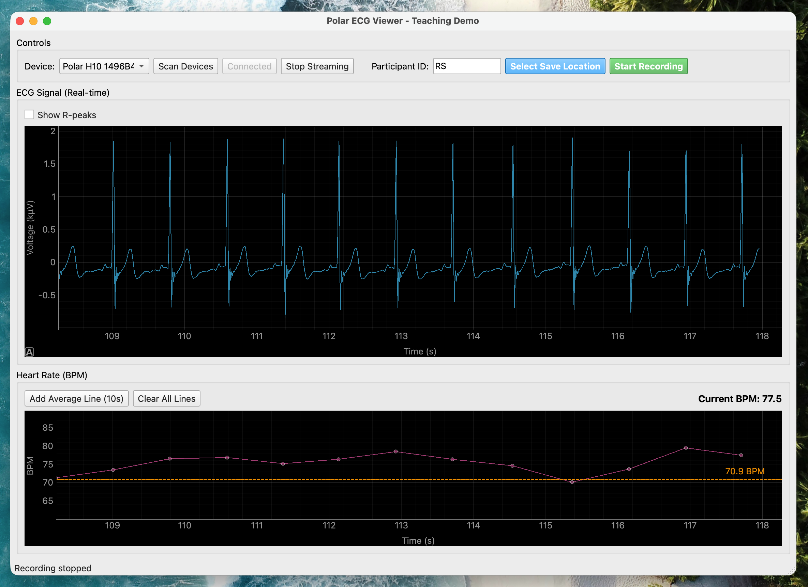
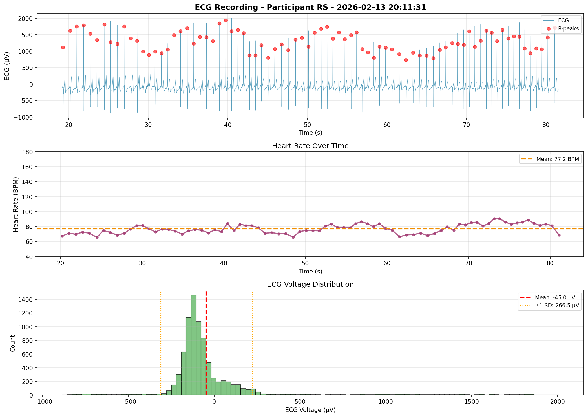

# Real-time Polar H10 ECG Viewer & Recorder

Real-time ECG visualization and recording tool for Polar H10 heart rate monitor. Built for teaching psychophysiology and conducting research with precise ECG data collection.



## Features

- **Real-time ECG Visualization** - Smooth, continuous 130 Hz ECG signal display
- **R-Peak Detection** - Automatic QRS complex detection with visual markers
- **Heart Rate Monitoring** - Live BPM calculation with smoothing
- **High-Precision Recording** - CSV export with microsecond-accurate timestamps
- **Visual Recording Markers** - See exactly when recording started/stopped
- **Analysis Tools** - Plot and validate recorded data
- **Configurable Display** - 20-second rolling window, coupled plots

## Installation

```bash
# Clone repository
git clone https://github.com/yourusername/polar-ecg-viewer.git
cd polar-ecg-viewer

# Install dependencies
pip install -r requirements.txt
```

**Requirements:**
- Python 3.8+
- Polar H10 heart rate monitor
- macOS, Linux, or Windows with Bluetooth LE support

## Quick Start

```bash
# Start the application
python main.py
```

**Workflow:**
1. Click **Scan Devices** → Select your Polar H10
2. Click **Connect** → **Start Streaming**
3. View real-time ECG and heart rate

### Recording Data

1. Enter Participant ID (e.g., "P001")
2. Click **Select Save Location** → Choose where to save
3. Click **Start Recording** → Recording begins immediately
4. Click **Stop Recording** when done

Green/red markers appear in plots showing exact start/stop times.

## Data Analysis

Recorded data is saved as CSV with precise timestamps:

```bash
# Visualize and validate recording
python plot_recording.py ECG_P001_20260213_153045.csv
```



The analysis script provides:
- ECG signal with detected R-peaks
- Heart rate over time
- Voltage distribution
- Timestamp validation
- Sample rate verification

## CSV Format

```csv
participant_id,sample_datetime,packet_received_datetime,polar_timestamp_s,ecg_voltage_uv
P001,2026-02-13T15:30:45.123456,2026-02-13T15:30:45.885456,0.000000,450.25
```

**Columns:**
- `participant_id` - Participant identifier
- `sample_datetime` - Exact datetime for each sample (back-calculated from packet arrival)
- `packet_received_datetime` - When BLE packet arrived (same for all samples in packet)
- `polar_timestamp_s` - Polar internal clock (seconds)
- `ecg_voltage_uv` - ECG voltage in microvolts

## Configuration

Edit `config.py` to customize:

```python
DISPLAY_WINDOW_SECONDS = 20        # Time window in plots
BPM_SMOOTHING_WINDOW = 2           # RR interval averaging
BPM_Y_AXIS_PADDING = 10           # BPM plot padding
SHOW_RPEAKS_DEFAULT = False        # R-peak markers on/off
DEBUG_PEAK_DETECTION = False       # Debug output
```

## Use Cases

**Teaching:**
- Demonstrate cardiac physiology in real-time
- Show respiratory sinus arrhythmia
- Visualize heart rate variability

**Research:**
- Collect high-quality ECG data
- Precise timing for experimental protocols
- Multi-session studies with participant tracking

## Technical Details

**ECG Processing:**
- Sample rate: 130 Hz
- R-peak detection: Adaptive threshold with scipy.signal
- BPM calculation: Smoothed over 2 RR intervals

**Time Synchronization:**
When a BLE packet arrives (~100 samples):
1. System time is captured (datetime.now())
2. Last sample gets exact arrival time
3. Earlier samples are back-calculated using sample rate
4. Each sample has precise real-world timestamp

**Display:**
- Time-based scrolling (continuous, like paper chart recorder)
- Linked X-axes (ECG and BPM scroll together)
- Auto-scaling Y-axes
- 30 FPS smooth animation

## Troubleshooting

| Issue | Solution |
|-------|----------|
| No device found | Check Polar H10 battery, wet electrodes |
| Connection fails | Restart H10, close other Bluetooth apps |
| No ECG visible | Check electrode contact, wait 5-10 seconds |
| Plot stutters | Reduce `SCROLL_UPDATE_INTERVAL_MS` in config |

## File Structure

```
polar-ecg-viewer/
├── main.py              # Main application (UI + real-time display)
├── polar_backend.py     # BLE connection + R-peak detection
├── config.py            # Configuration parameters
├── plot_recording.py    # Recording analysis tool
└── requirements.txt     # Python dependencies
```

## License

MIT License - See LICENSE file for details

## Acknowledgments

Built with:
- [polar-python](https://github.com/JuPfu/polar-python) - Polar device communication
- [PyQt6](https://www.riverbankcomputing.com/software/pyqt/) - User interface
- [pyqtgraph](https://www.pyqtgraph.org/) - High-performance plotting
- [scipy](https://scipy.org/) - Signal processing
- [Claude Sonnet 4.5](https://www.anthropic.com/news/claude-sonnet-4-5) – Vibe Coding
